# Comprehensive Comparison: Project I.G.I. Web Ports & Implementations

A structured evaluation and technical comparison of all known web-based ports, static recompilations, and clean-room engine reimplementations for **Project I.G.I.: I'm Going In** (2000).

---

## Architectural Classification

```mermaid
flowchart TD
    subgraph Decomp["1. Matching Decompilation"]
        A["Retail igi.exe"] --> B["Ghidra / IDA Disassembly"]
        B --> C["C/C++ Source Reconstruction"]
        C --> D["Emscripten WASM Build"]
    end

    subgraph Recomp["2. Static Binary Recompilation"]
        E["Retail igi.exe (x86 PE32)"] --> F["Instruction Lifter (x86 -> C/IR)"]
        F --> G["Portable C Glue + WebGPU/WASM"]
        G --> H["sagarinfosec / igi-browser"]
    end

    subgraph CleanRoom["3. Clean-Room Engine Reimplementation"]
        I["Binary Analysis Ledger (Ghidra + REA)"] --> J["Modern High-Level Engine (TS / C#)"]
        J --> K["Three.js / WebGL / Uno-WebGPU"]
        K --> L["Reimagine-IGI & OpenIGI Web"]
    end
```

---

## Detailed Comparison Table

| Project | Underlying Technique | Language & Graphics Stack | Asset Pipeline | Missions & Scope | Unique Distinctions | Rating (1–100) |
| :--- | :--- | :--- | :--- | :--- | :--- | :---: |
| **[Reimagine-IGI (`re-igi`)](https://github.com/Haseebraza12/reimagine-igi)** *(By Haseeb ur Rehman)* | **Clean-Room Web Reimplementation** *(Derived via Ghidra + REA)* | **TypeScript + Vite + Three.js** *(WebGL)* | Zero pre-conversion; reads original `.res`, `.qvm`, `.mef` directly at runtime client-side. | **All 14 Missions** (Full game) | 100% browser-native pure JS/TS stack. Decodes original bytecode VM (all 49 opcodes), complete 49-state player movement graph, vehicle physics, octree terrain with LOD geomorphing. No WASM layer needed. | **92 / 100** |
| **[OpenIGI Web](https://openigi.com/)** *(By ShahriyarB)* | **Clean-Room Reimplementation** | **C# (.NET 10) + WebAssembly** *(WebGPU / WebGL via Uno Platform)* | Reads user files locally; optional high-res asset packs. | **Full IGI 1 & IGI 2** | Unified multi-game engine. Supports both IGI 1 and IGI 2 under one modern architecture. Also ships native macOS, Linux, and Windows desktop versions. | **95 / 100** |
| **[Project I.G.I. Web & Desktop](https://rishabhgupta3107.github.io/igi-browser/)** *(By rishabhgupta3107)* | **Static Recompilation / Web Wrapper** | **WebGPU + C / WASM + Desktop Shells** | One-time local folder selection; saved to browser storage. | Campaign missions playable | Modernized WebGPU graphics pipeline, widescreen aspect ratio, Max Payne-style slow-motion dive mechanic, controller support, and prebuilt native macOS Apple Silicon/Intel desktop apps. | **90 / 100** |
| **[Project I.G.I. Web (ReComp)](https://github.com/sagarinfosec/project-igi-browser)** *(By sagarinfosec)* | **Static Binary Recompilation** | **C/C++ lifted from x86 -> WebAssembly** | Pre-bundled / streamed web assets. | Level slices | Focuses on raw x86 execution preservation via Ahead-of-Time static binary lifting. Closest to native engine logic speed, but rigid to modify. | **82 / 100** |
| **[Project I.G.I. Web (Vanilla)](https://project-igi.pages.dev/)** | **Emscripten / Port Wrapper** | **C/C++ + Emscripten + WebGL** | Pre-bundled vanilla assets. | Mission 1 (Trainyard) slice | Instant click-to-play with zero setup or file-picking. Highly faithful vanilla experience, but limited in scope and lacking modern engine tooling. | **78 / 100** |

---

## What Makes Reimagine-IGI (`re-igi`) Different?

1. **Pure Web-Native Technology (No WebAssembly Black Box):**
   - Unlike the recompiled ports that compile lifted C/x86 code into opaque `.wasm` blobs, `reimagine-igi` is written from the ground up in readable **TypeScript and Three.js**.
   - Developers can inspect, debug, and hot-reload level logic, AI states, and rendering pipelines directly in Chrome/Safari DevTools.

2. **Full In-Memory Format Parsing:**
   - It contains standalone TypeScript loaders for the proprietary Innerloop formats (`.qvm` bytecode VM, `.mef` 3D meshes, `.res` ILFF archives, `.tex` texture blocks, and `.iff` skeletal animation clips) without needing native C helper libraries.

3. **Ghidra/REA-Backed Rigorous Math Recovery:**
   - Its physics and AI aren't approximations: the 49-state movement graph, root-motion multiplier ($\times 1.75$), 3-ray character collision sweep, and FPU chop-rounding weapon cooldown timers are matched to original `igi.exe` disassembly via a recorded evidence ledger.

---

## Detailed Scoring Breakdown (1 to 100)

### 1. OpenIGI Web: **95 / 100**
- **Pros:** Massive engineering scope (.NET 10), unified support for both games (IGI 1 & IGI 2), active modding platform, desktop and web builds.
- **Cons:** Heavy runtime download compared to pure web scripts.

### 2. Reimagine-IGI (`re-igi`): **92 / 100**
- **Pros:** Outstanding browser-native architecture (Three.js/TypeScript), all 14 missions supported, zero-dependency client-side decoding, clean evidence ledger.
- **Cons:** WebGL rendering rather than modern WebGPU compute pipelines.

### 3. IGI Browser (rishabhgupta3107): **90 / 100**
- **Pros:** Native WebGPU renderer, smooth widescreen visuals, standalone macOS Apple Silicon releases (`.zip`), slow-mo dive mechanic.
- **Cons:** Less modular codebase for modders than clean-room TypeScript/C#.

### 4. Project I.G.I. Web ReComp (sagarinfosec): **82 / 100**
- **Pros:** High tick-rate faithfulness from static binary recompilation.
- **Cons:** Difficult to customize or extend beyond original game constraints.

### 5. Project I.G.I. Web Vanilla (Pages.dev): **78 / 100**
- **Pros:** Zero setup; instant 1-click playable in any browser.
- **Cons:** Single vertical slice, vanilla 4:3 fixed constraints, no campaign expansion.
